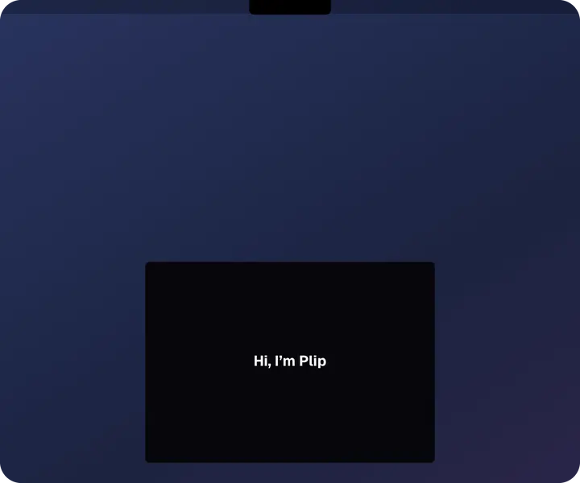
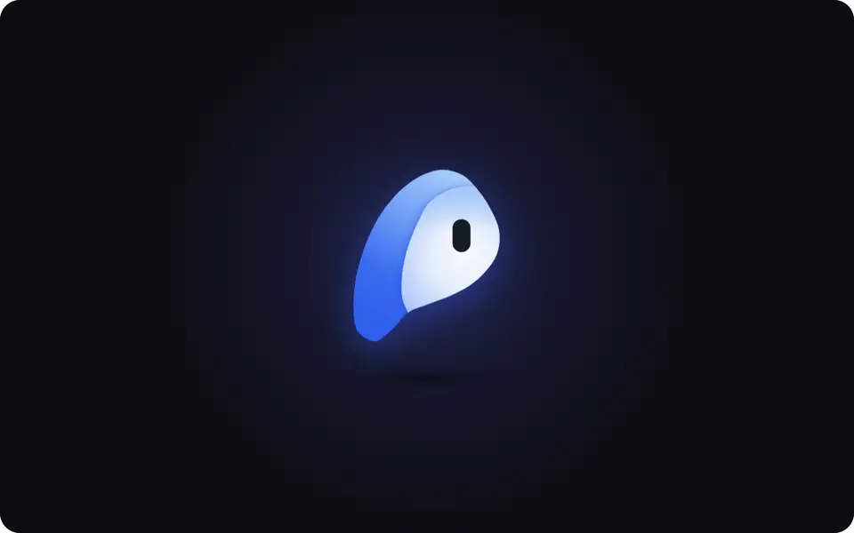
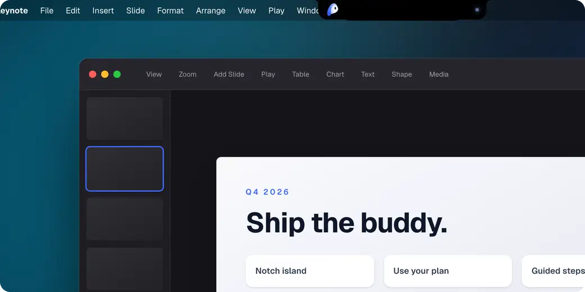
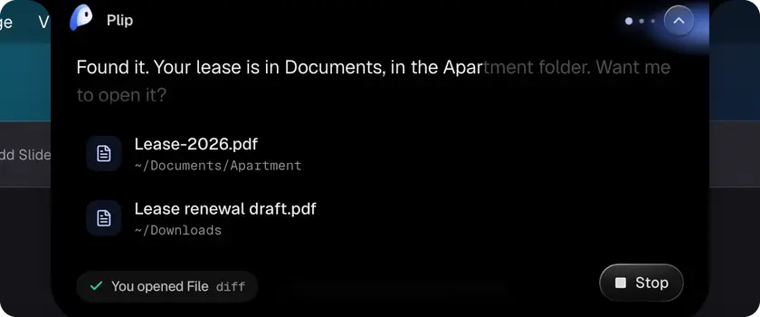
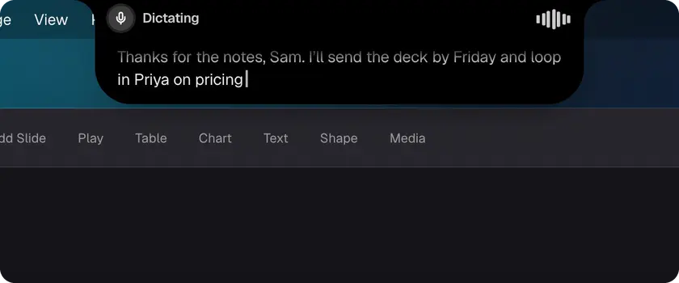
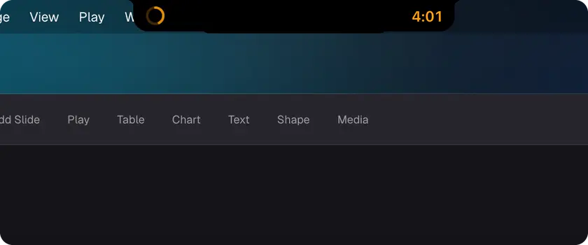
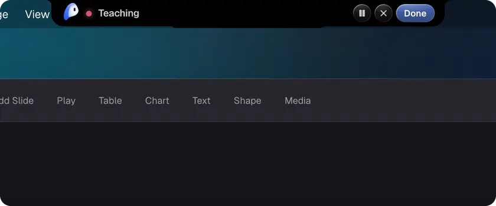

<p align="center">
  
</p>

<h1 align="center">Plip</h1>

<p align="center">
  <b>Personal staff that lives in your MacBook's notch.</b><br>
  Hold <kbd>control</kbd> <kbd>option</kbd> and ask. Plip sees your screen, shows you where to click,<br>
  and does the busywork for you.
</p>

<p align="center">
  <a href="https://github.com/hussainn7/plip-oss/releases/latest"></a>
</p>

<p align="center">
  <sub>Signed and notarized by Apple&nbsp;&nbsp;·&nbsp;&nbsp;Runs on the Claude, ChatGPT, Cursor or Gemini plan you already pay for&nbsp;&nbsp;·&nbsp;&nbsp;Open source</sub>
</p>

<br>

<p align="center">
  
</p>

<br>

## Ask. It shows you the way.



*"How do I export this as a PDF?"* The steps drop out of the notch, and Plip flies over to point at each click.
It watches your screen and moves on as you go. Works in any app.

<br>

## And it takes care of the rest

<table>
  <tr>
    <td width="50%" valign="top">
      
      <h3>Finds it. Does it.</h3>
      <i>"Find my lease." "Tidy my desktop."</i><br>
      Plip searches your Mac and opens the right file. Anything that moves, sends or buys shows you the plan first and
      waits for your yes.
    </td>
    <td width="50%" valign="top">
      
      <h3>Dictation, anywhere</h3>
      Hold <kbd>fn</kbd> <kbd>control</kbd> and talk. Your words show up in the notch as you speak, then land wherever
      your cursor is, in any app. Undo or copy them after.
    </td>
  </tr>
  <tr>
    <td width="50%" valign="top">
      
      <h3>Lives in your notch</h3>
      Timers and music sit in the notch, iPhone style. Hover over it to type to Plip when you can't talk out loud.
    </td>
    <td width="50%" valign="top">
      
      <h3>Teach it once</h3>
      Do a task once while Plip watches, like filing an expense. It becomes a skill you can run just by asking.
    </td>
  </tr>
</table>

<br>

## Just ask

| Say | Plip |
|---|---|
| *"What does this error mean?"* | reads it off your screen and explains it |
| *"Flights to Miami next Friday"* | opens Google Flights and points at the cheapest |
| *"Rewrite this to sound friendlier"* | rewrites the text you selected, right where it is |
| *"Remind me to call the dentist at 4"* | adds it to Reminders |
| *"Play something chill"* | starts a playlist in Spotify |
| *"Remember I prefer aisle seats"* | keeps it, and uses it next time |

It also takes notes on your calls in one click, answers to *"Hey Plip"* hands-free, and remembers what you tell it.

<br>

## Use the AI you already pay for

| You have | Plip connects in one click |
|---|---|
| **Claude** Pro or Max | Claude Code, with a browser sign-in |
| **ChatGPT** Plus or Pro | the Codex CLI, with a browser sign-in |
| **Cursor** | the Cursor CLI |
| **Google AI** Pro or Ultra | Gemini, through Antigravity |
| No AI plan | a free Google AI Studio key |
| A model on your Mac | Ollama or LM Studio |

Already signed in to one of these? Plip finds it.

<br>

## Get started

1. **[Download Plip](https://github.com/hussainn7/plip-oss/releases/latest)**, drag it into Applications and open it.
2. **A one-minute welcome** turns on the permissions it needs and connects your AI.
3. **Hold <kbd>control</kbd> <kbd>option</kbd>**, ask, let go.

Updates install themselves. Something broken? Click the bug icon in Settings or **Report a bug** in the menu bar, or
[open an issue](https://github.com/hussainn7/plip-oss/issues).

<br>

## Private by default

- **It listens only while you hold the keys.** Choose Parakeet in Settings and your voice never leaves your Mac.
- **Your screen goes only to the AI you picked**, under your own account. Screenshots aren't kept.
- **Nothing big happens without you.** Buying, sending, posting, deleting or moving files waits for your yes, and
  *"undo"* puts a tidy-up back.
- **Analytics are counts, never content**: nothing you say, type or see. Turn them off in **Settings › General**.

<details>
<summary><b>Everything that leaves your Mac</b></summary>
<br>

- **To the AI you picked**, with each ask: your question, the screenshots, the text on screen (app and window names,
  the page address, what you've selected, visible text and button names), your recent conversation, and what Plip
  knows about you. It goes to Anthropic, OpenAI, Cursor or Google under your own account and their terms. Cursor and
  Gemini through Antigravity get the text but not the screenshots. On Google's free key, Google may use what Plip
  sends (screenshots included) to improve its products, and human reviewers may read it (outside the EEA,
  Switzerland and the UK; see the [Gemini API terms](https://ai.google.dev/gemini-api/terms)), so use a paid plan
  for private work. A model in Ollama or LM Studio keeps all of it on your Mac.
- **Analytics**, on by default: a random install id, the Plip and macOS versions, and counts of what happened (a
  setup step reached, what kind of task it was, how it ended and how long it took). Never what you ask, say, type or
  see, and no file names, web addresses or app names. Switch it off in **Settings › General › Share anonymous
  usage**, or set `DO_NOT_TRACK=1`.
- **Report a bug** and **Request a feature** send what you type (a bug report also sends the details you leave
  ticked), and the occasional check-in sends your answers, only when you press Send.
- **Your account**: a guest account with a random name like *Quiet Nomad*, so people can be counted. **Continue with
  Google** is optional and adds your name, email and picture. Nothing you ask, see or remember is sent to it.
- **Update check**: Plip asks GitHub for the latest release at launch and every few hours, with nothing about you in it.
- **Voice**: Apple's speech recognizer may send your voice to Apple. Parakeet runs on your Mac. ElevenLabs gets each
  sentence Plip speaks, only if you add its key.

**What stays on your Mac:** what Plip knows about you, your history and your usage log. Passport, card and similar
numbers stay on your Mac too: the AI only ever sees their label.

**What Plip won't do on its own:** your AI can only answer in words. Plip runs it in an empty, throwaway folder with
its tools switched off, and does every action itself. It asks you first before anything that buys, sends, submits,
posts or deletes, and before opening a file that can run things.

</details>

<details>
<summary><b>Permissions, and what each one is for</b></summary>
<br>

| Permission | What Plip does with it |
|---|---|
| **Microphone** | Listens while you hold the keys, and stops when you let go. |
| **Screen Recording** | Takes a screenshot when you let go, so your AI sees what you see. Plip's own windows are left out. |
| **Accessibility** | Hears the shortcut, reads the names and positions of buttons so Plip points at real ones, and clicks and types for you. |
| **Speech Recognition** | Only for Apple's recognizer. Not needed with Parakeet. |
| **Automation** (optional) | Asked the first time a skill needs another app: Notes, Reminders, Mail, Finder, Safari or Chrome. |

The welcome asks for each one at the moment it's needed and opens the right page in System Settings.

</details>

<details>
<summary><b>Under the hood</b></summary>
<br>

```
⌃⌥ ──▶ mic ──▶ Parakeet / Apple Speech ──▶ transcript ──▶ the notch (live)
                                              │
 screenshots ──────────────┐                  ▼
 Accessibility screen map ─┼──▶ your AI (Claude Code / Codex / Cursor / Gemini / a local model), streamed
 what Plip knows about you ┘        ├─▶ sentences ──▶ spoken as they arrive
                                    ├─▶ [POINT]  ──▶ snapped to the real control ──▶ Plip flies out to it
                                    ├─▶ [STEPS]  ──▶ a checklist in the notch, checked off as you go
                                    └─▶ [DO]     ──▶ Plip runs it itself ──▶ your yes first, if it matters
```

- **Screen map.** Plip lists the real controls of the app in front, so your AI points at things that exist and
  text-only AIs can still point.
- **Walkthroughs.** A tiny fingerprint of the screen tells Plip when you've done a step, then it looks again before
  giving the next one.
- **Actions.** Plip runs them on your Mac itself (Spotlight, AppleScript, Shortcuts, Accessibility), with timeouts,
  an undo history and a local log.

</details>

<details>
<summary><b>Run it from source</b></summary>
<br>

```bash
curl -fsSL https://raw.githubusercontent.com/hussainn7/plip-oss/main/scripts/install.sh | bash
plip                 # Plip moves into your notch; the dashboard opens on first run
plip ask --image screenshot.png "where's the export button?"
```

From a terminal, macOS checks the terminal's permissions rather than Plip's: turn on your terminal under **System
Settings › Privacy & Security › Accessibility**. `plip doctor` checks AIs, keys and permissions. More in
[CONTRIBUTING.md](CONTRIBUTING.md).

</details>

<br>

<p align="center">
  <br>
  <sub><a href="https://plip.dev">plip.dev</a>&nbsp;&nbsp;·&nbsp;&nbsp;<a href="https://plip.dev/privacy">Privacy</a>&nbsp;&nbsp;·&nbsp;&nbsp;<a href="https://github.com/hussainn7/plip-oss/issues">Report a bug</a>&nbsp;&nbsp;·&nbsp;&nbsp;MIT license</sub>
</p>
